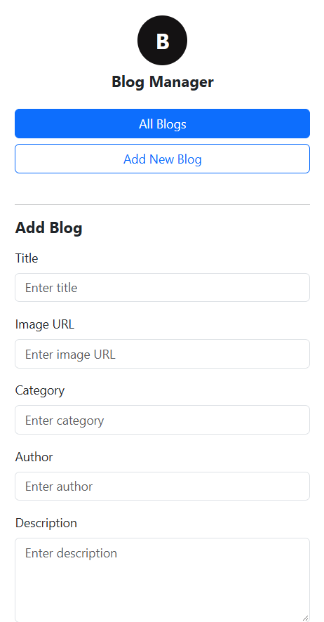
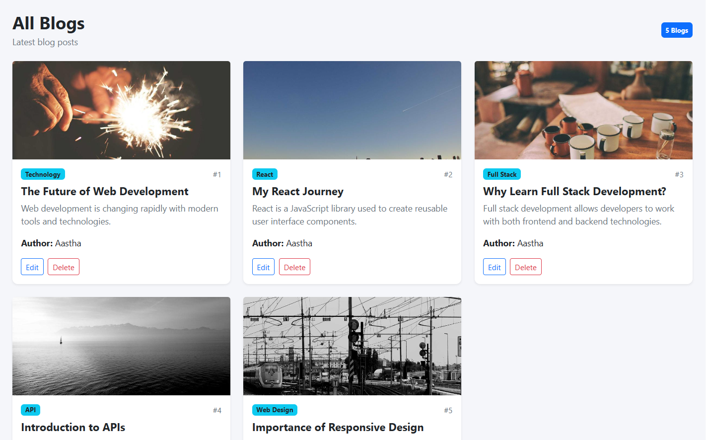

# 📝 Blog Management App

A simple and responsive **Blog Management Application** built using **React.js** and **JSON Server**.

This project allows users to create, view, update, and delete blog posts through a simple and user-friendly interface.

---

## 🚀 Technologies Used

* HTML
* CSS
* Bootstrap
* JavaScript
* React.js
* JSON Server
* REST API

---

## ✨ Features

* Create a new blog post
* View all blog posts
* Edit existing blog posts
* Delete blog posts
* Blog creation form
* Blog title and image
* Blog category
* Blog description
* Blog author
* Responsive blog cards
* Fixed blog form layout
* Simple and attractive user interface
* Dynamic blog rendering
* React state management
* Event handling
* Conditional rendering
* REST API integration
* CRUD operations

---

# 🔄 Project Workflow

The application works through the following workflow:

```text
User
  ↓
React Application
  ↓
Blog Form
  ↓
Enter Blog Details
  ↓
CRUD Operation
  ↓
JSON Server
  ↓
Blog Data
  ↓
React State
  ↓
Blog Cards
  ↓
Display Blog Collection
```

---

## 1️⃣ Blog Form

The blog form allows users to enter the required information for creating or updating a blog post.

The user enters the blog details and submits the form.

```text
Blog Form
    ↓
Enter Blog Details
    ↓
Form Submission
    ↓
Handle Submit
    ↓
API Request
    ↓
JSON Server
    ↓
Blog Data
    ↓
React State
```

The form is displayed on the left side of the screen, while the blog collection is displayed on the right side.

The form contains the following fields:

* Blog Title
* Image URL
* Category
* Author
* Description

---

## 2️⃣ CREATE – Add Blog

When the user enters the blog details and clicks the **Add Blog** button, a new blog post is created.

```text
Blog Form
    ↓
Blog Title
    ↓
Image URL
    ↓
Category
    ↓
Author
    ↓
Description
    ↓
Add Blog Button
    ↓
Handle Submit
    ↓
POST Request
    ↓
JSON Server
    ↓
New Blog Added
    ↓
Display Blog Card
```

The new blog is added to the blog collection and displayed dynamically using React.

The blog data is sent to JSON Server using the **POST** method.

```javascript
fetch(API, {
  method: "POST",
  headers: {
    "Content-Type": "application/json"
  },
  body: JSON.stringify(blog)
})
```

---

## 3️⃣ READ – Display Blogs

When the application starts, the existing blog posts are retrieved from the JSON Server.

```text
Application Starts
    ↓
useEffect()
    ↓
getData()
    ↓
GET Request
    ↓
JSON Server
    ↓
Blog Data
    ↓
setBlogData()
    ↓
Blog Cards
    ↓
Display Blog Collection
```

The application uses the **GET** method to retrieve all blog posts.

```javascript
fetch(API, {
  method: "GET",
  headers: {
    "Content-Type": "application/json"
  }
})
```

The blog data is stored inside React state using:

```javascript
const [blogData, setBlogData] = useState([]);
```

The blogs are displayed dynamically using the `map()` function.

```javascript
blogData.map((element, index) => {

})
```

---

## 4️⃣ ✏️ UPDATE – Edit Blog

The **Edit** button allows the user to update an existing blog post.

```text
Click Edit
    ↓
handleEdit()
    ↓
Select Blog
    ↓
Blog Data Loaded Into Form
    ↓
Change Blog Details
    ↓
Update Blog Button
    ↓
PUT Request
    ↓
JSON Server
    ↓
Updated Blog
    ↓
getData()
    ↓
Display Updated Blog
```

When the user clicks the Edit button, the selected blog information is loaded into the form.

```javascript
const handleEdit = (element) => {

  setIsAdd(false);

  setId(element.id);

  setTitle(element.title);
  setImage(element.image);
  setCategory(element.category);
  setDescription(element.description);
  setAuthor(element.author);

}
```

The blog is updated using the **PUT** method.

```javascript
fetch(`${API}/${id}`, {
  method: "PUT",
  headers: {
    "Content-Type": "application/json"
  },
  body: JSON.stringify(blog)
})
```

---

## 5️⃣ 🗑️ DELETE – Delete Blog

The **Delete** button allows the user to remove a blog post.

```text
Click Delete
    ↓
handleDelete()
    ↓
Blog ID
    ↓
DELETE Request
    ↓
JSON Server
    ↓
Blog Deleted
    ↓
getData()
    ↓
Updated Blog Collection
```

The blog is deleted using the **DELETE** method.

```javascript
fetch(`${API}/${id}`, {
  method: "DELETE",
  headers: {
    "Content-Type": "application/json"
  }
})
```

---

# 🔁 Blog Operations

| Operation | Description |
| --------- | ----------- |
| Create | Create a new blog post |
| Read | Display blog posts |
| Update | Edit an existing blog post |
| Delete | Delete a blog post |
| State Management | Manage blog data using React state |
| Rendering | Display dynamic blog cards |

---

# 🌐 API Integration

The project uses **JSON Server** as a simple backend to store and manage blog data.

### API URL

```text
http://localhost:3000/blogs
```

### API Operations

```text
GET
POST
PUT
DELETE
```

---

# 📦 Blog Data

Each blog contains the following information:

```json
{
  "id": "1",
  "title": "The Future of Web Development",
  "image": "https://picsum.photos/seed/webdevelopment/800/500",
  "category": "Technology",
  "description": "Web development is changing rapidly with modern tools and technologies.",
  "author": "Aastha"
}
```

---

# 🖥️ Project Output / Screenshots

## 📝 Blog Creation Form

The form is used to enter blog information such as the blog title, image URL, category, author and description.



---

## 📚 Blog Collection

The blog collection displays the created blog posts in a responsive card layout.

Each blog card contains:

* Blog Image
* Blog Category
* Blog Title
* Blog Description
* Author
* Edit Button
* Delete Button



---

# 📸 Project Screenshots

The project screenshots are stored inside the `src/assets` folder.

```text
src/
└── assets/
    ├── form.png
    └── collection.png
```

---

# 🎥 Video Explanation

## Project Explanation Video

In this video, I explain the complete **Blog Management Project**, including:

* Project introduction
* React application structure
* Blog form
* useState
* useEffect
* Event Handling
* Form Handling
* Conditional Rendering
* Creating blog posts
* Displaying blog cards
* Editing blog posts
* Deleting blog posts
* CRUD Operations
* GET API
* POST API
* PUT API
* DELETE API
* JSON Server
* REST API
* Dynamic rendering using map()
* Project output

### ▶️ Video Link

[Watch Project Explanation Video]  (https://drive.google.com/file/d/1Yt3Bh_zfHKC42kBCtXQagt8h5S9X22_H/view?usp=sharing)

---

# ⚙️ How to Run the Project

## 1. Clone Repository

```bash
git clone YOUR_GITHUB_REPOSITORY_LINK
```

---

## 2. Open Project

```bash
cd blog-project
```

---

## 3. Install Dependencies

```bash
npm install
```

---

## 4. Install JSON Server

```bash
npm install json-server
```

---

## 5. Start JSON Server

Open another terminal and run:

```bash
npx json-server db.json --port 3000
```

The API will run at:

```text
http://localhost:3000/blogs
```

---

## 6. Start React Application

Run:

```bash
npm run dev
```

Then open the local URL provided by Vite in your browser.

---

# 📂 Project Structure

```text
blog-project/
│
├── src/
│   ├── assets/
│   │   ├── form.png
│   │   └── collection.png
│   │
│   ├── App.jsx
│   └── main.jsx
│
├── public/
│
├── db.json
├── index.html
├── package.json
├── package-lock.json
└── README.md
```

---

# 🧠 React Concepts Used

* useState
* useEffect
* Event Handling
* Form Handling
* Conditional Rendering
* map()
* State Management
* Component-Based Architecture
* Dynamic Rendering
* JSX
* API Integration
* CRUD Operations

---

# 🔧 Functions Used

## getData()

The `getData()` function is used to retrieve all blog posts from the JSON Server.

```javascript
getData()
```

It uses the **GET** method to fetch the blog data.

---

## handleSubmit()

The `handleSubmit()` function is used for both adding and updating blog posts.

```javascript
handleSubmit()
```

It performs:

```text
Add Blog
   ↓
POST

Update Blog
   ↓
PUT
```

---

## handleDelete()

The `handleDelete()` function is used to delete a selected blog post.

```javascript
handleDelete(id)
```

It sends a **DELETE** request to the JSON Server.

---

## handleEdit()

The `handleEdit()` function is used to load the selected blog information into the form.

```javascript
handleEdit(element)
```

It changes the form from **Add Blog** mode to **Edit Blog** mode.

---

## handleCancel()

The `handleCancel()` function is used to cancel the edit operation and clear the form.

```javascript
handleCancel()
```

---

# 🎨 UI Design

The project includes a simple and responsive user interface with:

* Fixed blog form on the left side
* Blog collection on the right side
* Bootstrap cards
* Responsive blog cards
* Blog images
* Category badges
* Edit and Delete buttons
* Add and Update buttons
* Simple navigation section
* User-friendly form design
* Clean background
* Responsive layout

The layout is designed to display the form and blog collection within the available screen space.

---

# 🎯 Project Purpose

The main purpose of this project is to understand how **React.js works with APIs and manages dynamic data** using state, event handling and CRUD operations.

This project helped me improve my practical knowledge of:

* React.js
* State Management
* useState
* useEffect
* Form Handling
* Event Handling
* REST API
* JSON Server
* CRUD Operations
* Dynamic Rendering
* Bootstrap
* Responsive Web Design

---

# 📚 What I Learned

Through this project, I learned how to:

* Create a React application using Vite
* Manage blog data using useState
* Use useEffect when the application loads
* Handle form inputs in React
* Create and display blog posts
* Render dynamic data using map()
* Create blog posts using POST
* Display blog posts using GET
* Update blog posts using PUT
* Delete blog posts using DELETE
* Connect React with JSON Server
* Work with REST APIs
* Update the user interface using React state
* Handle Add and Edit operations using conditional rendering
* Create responsive layouts using Bootstrap
* Build a simple and user-friendly blog interface

---

# 🔄 CRUD Workflow

The complete CRUD workflow of the project is:

```text
CREATE
  ↓
POST
  ↓
Add Blog
  ↓
JSON Server

READ
  ↓
GET
  ↓
Display Blogs
  ↓
React Cards

UPDATE
  ↓
PUT
  ↓
Edit Blog
  ↓
JSON Server

DELETE
  ↓
DELETE
  ↓
Remove Blog
  ↓
JSON Server
```

---

# 📌 Conclusion

The **Blog Management App** is a React-based CRUD application that demonstrates how frontend applications can communicate with a backend API.

Using React.js and JSON Server, the project provides functionality to:

* Add blogs
* View blogs
* Edit blogs
* Delete blogs

The project provides practical experience with **React, API integration, JSON Server, Bootstrap, state management, form handling and CRUD operations**.

---

# 👨‍💻 Author

**Aastha**

Full Stack Development Student
